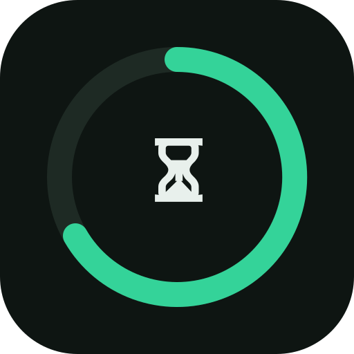

<div align="center">



<h1>⏳ FastTrack</h1>

**Offline-first PWA to track intermittent fasting & weight — and see where you're headed.**

Log your fasts and weigh-ins, then get a weight-trend projection of where you'll be in 30 days.

<br/>


<br/>

<code>Fasting timer</code>
<code>Weight projection</code>
<code>Streaks</code>
<code>Water</code>
<code>Measurements</code>
<code>Private</code>

</div>

---

## ✨ Features

- ⏳ **Fasting timer** — progress ring with presets (13:11, 16:8, 18:6, 20:4, OMAD, 36h) or a custom goal, editable start time mid-fast, and a milestone celebration when you hit your goal.
- 🔬 **Fasting stages** — live "what's happening in your body" education (fed → glycogen → ketosis → autophagy → HGH → regeneration) as your fast progresses.
- 📅 **History & streaks** — log past fasts without weird day resets, browse completed fasts, and build a daily streak.
- 📈 **Weight projection** — log weigh-ins, see an SVG trend chart, and get a 30-day linear-regression forecast plus an estimated date you'll reach your goal weight.
- 💧 **Water, measurements & metrics** — daily water goal, body measurements, and blood/electrolyte metrics (glucose, ketones, BP, sodium, potassium, magnesium).
- 📝 **Notes** — journal how each fast felt.
- 🌗 **Dark / light theme** — follows your system automatically.
- 📴 **Offline & private** — everything is stored on-device in `localStorage`; no account, no backend, no network calls. Back up any time with JSON export/import.

## 🚀 Run it

```sh
python3 -m http.server 8000
# open http://localhost:8000
```

It's a static, zero-build app — any static host works. Once deployed over HTTPS, install it from your browser:

- **Android (Chrome):** ⋮ menu → **Add to Home screen**
- **iPhone/iPad (Safari):** Share → **Add to Home Screen**

## 🔒 Data & privacy

Your fasts, weight, water, measurements, and notes never leave your device. Data is per-browser, so **Settings → Export** is your backup and how you move data between devices.

## 🛠️ Tech

Pure HTML, CSS, and vanilla JavaScript — no framework, no build step, no runtime dependencies. Offline support via a stale-while-revalidate service worker.
